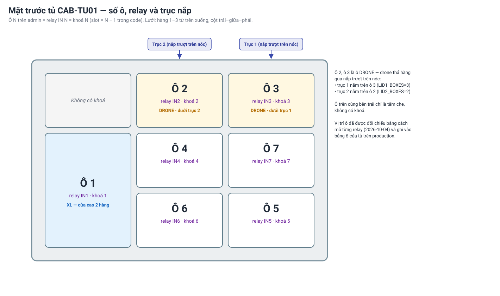
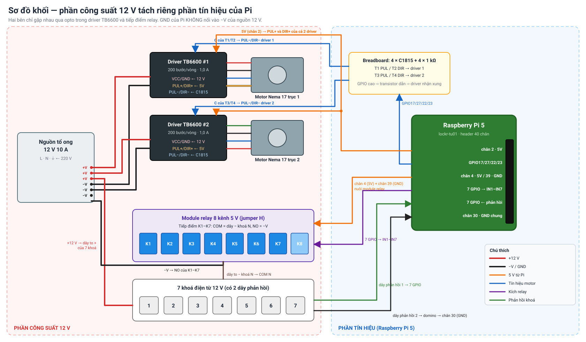
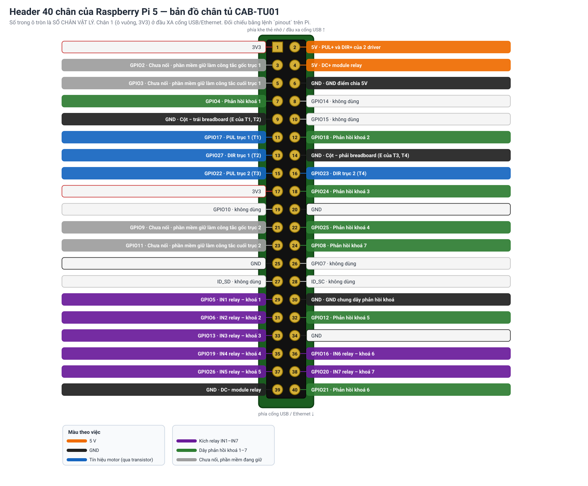
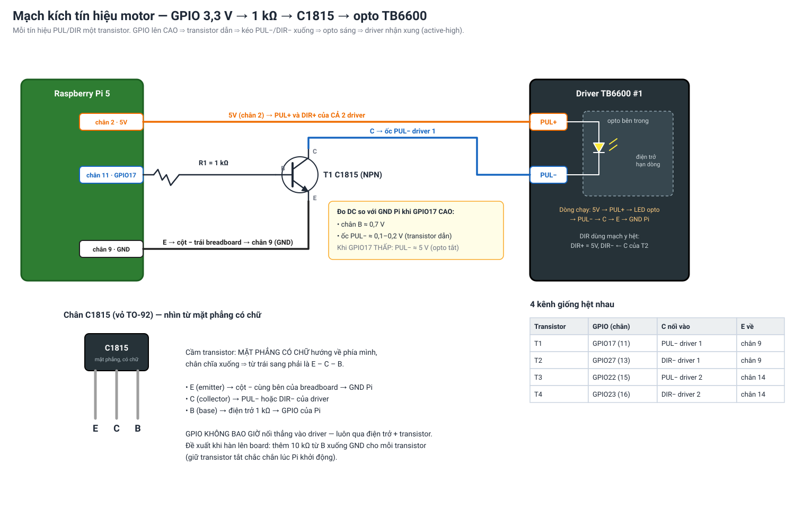
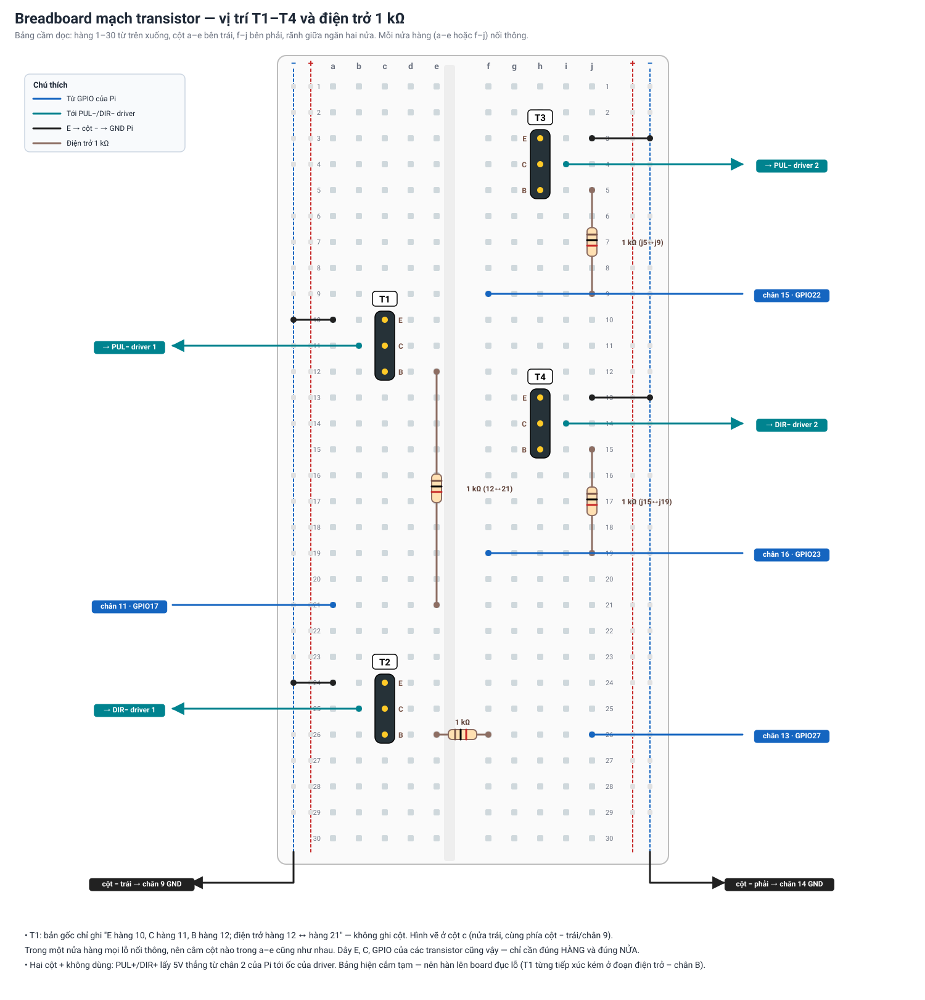
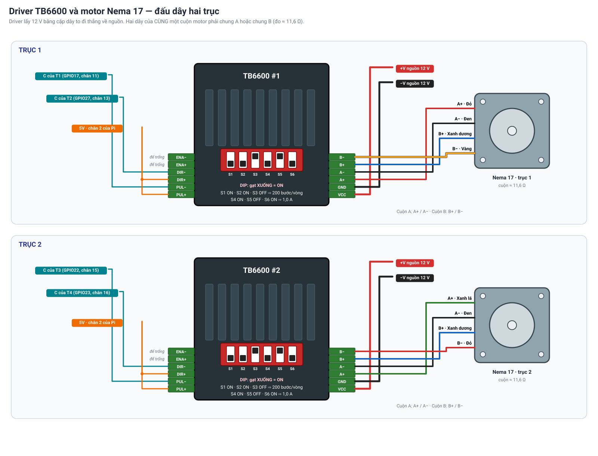
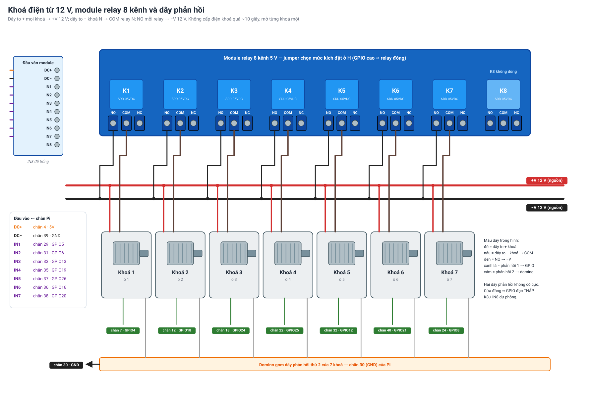

# Sơ đồ tổng quan tủ `CAB-TU01`

| | |
|---|---|
| **Dùng khi** | Cần biết tủ thật đang nối thế nào, Pi đang chạy cấu hình gì, hoặc sửa/thay một linh kiện |
| **Hiệu lực** | Từ **2026-11-03** — bản nối dây hiện tại của tủ. Các bản đồ chân cũ trong [cabinet-wiring-spec § 6.1](cabinet-wiring-spec.md), [tu01-wiring-photos](tu01-wiring-photos.md), [pi-lockr-tu01](pi-lockr-tu01.md) và mặc định trong code **không còn đúng** với tủ này |
| **Nguồn** | Bản "Sơ đồ tổng quan Tủ Locker CAB-TU01" của nhóm (ThuyHangcute, 03/11/2026) + cấu hình đã áp và đo trên Pi cùng ngày |
| **Hình** | `img/tu01-so-do/*.svg`, sinh bằng `python scripts/ve-so-do-tu01.py` — sửa số chân trong bảng đầu script rồi chạy lại, không sửa tay file SVG |
| **Gap** | F2-G09 |

Raspberry Pi 5 điều khiển **2 trục vít me** (2 driver TB6600 kích qua transistor C1815) và **7 khoá điện từ 12 V** (module relay 8 kênh), cấp nguồn bởi **nguồn tổ ong 12 V 10 A**.

Quy ước dùng trong cả tài liệu:
- **Số chân** là số chân vật lý trên header 40 chân của Pi; **GPIO** là số BCM mà phần mềm dùng.
- **Ô N** trên admin = khoá N = relay `IN N` (`slot = N − 1` trong code).

## 0. An toàn

- Tắt nguồn 12 V trước khi lắp ráp cơ khí hoặc chạm vào khu vực driver.
- Tắt Pi bằng `sudo poweroff` trước khi rút điện — thẻ nhớ đã từng lỗi đọc ghi một lần.
- GPIO của Pi chỉ chịu 3,3 V. Không nối GPIO thẳng vào driver; luôn qua điện trở 1 kΩ và transistor (§ 4).
- Không cấp điện cho khoá liên tục quá khoảng 10 giây; chỉ mở từng khoá một.
- **Đổi dây thì đổi cấu hình phần mềm trước khi bật lại `lockr-controller`** (§ 7). Phần mềm chạy bản đồ chân cũ trên dây mới có thể kích relay liên tục hoặc đẩy một GPIO lên cao trong khi chân đó đang nối GND.

## 1. Mặt trước tủ



| Ô | Vị trí (hàng, cột) | Loại | Ghi chú |
|---|---|---|---|
| 1 | hàng 2–3, trái | XL (cửa cao) | |
| 2 | hàng 1, giữa | DRONE | Dưới trục nắp 2 |
| 3 | hàng 1, phải | DRONE | Dưới trục nắp 1 |
| 4 | hàng 2, giữa | | |
| 5 | hàng 3, phải | | |
| 6 | hàng 3, giữa | | |
| 7 | hàng 2, phải | | |
| — | hàng 1, trái | | Tấm che, không có khoá |

## 2. Sơ đồ khối

Phần công suất 12 V (driver, motor, khoá) tách riêng phần tín hiệu của Pi. Hai bên chỉ gặp nhau qua opto bên trong driver và tiếp điểm relay — GND của Pi **không** nối vào −V của nguồn 12 V.



```
                 ┌── VCC/GND ──► Driver 1 ──► Motor trục 1
Nguồn 12V 10A ──┼── VCC/GND ──► Driver 2 ──► Motor trục 2
                 └── +12V ──► 7 khoá ──► COM/NO relay ──► −12V

Raspberry Pi 5
 ├─ 5V (chân 2) ──► PUL+ / DIR+ của 2 driver
 ├─ GPIO 17/27/22/23 ──1kΩ──► 4 transistor C1815 ──► PUL− / DIR−
 ├─ 5V (chân 4) + GND (chân 39) ──► nguồn module relay 8 kênh
 ├─ 7 GPIO ──► IN1–IN7 module relay
 └─ 7 GPIO ◄── dây phản hồi khoá (GND chung chân 30)
```

## 3. Bảng chân Pi

Chân 1 (ô vuông, 3V3) nằm ở đầu **xa** cổng USB/Ethernet. Đối chiếu bằng lệnh `pinout` trên Pi trước khi cắm — đã từng có lần đếm chân từ phía cổng USB nên bị ngược.



| Chân | GPIO | Dùng cho |
|---:|---|---|
| 2 | 5V | PUL+ và DIR+ của 2 driver |
| 4 | 5V | DC+ module relay |
| 6 | GND | GND điểm chia 5V |
| 7 | 4 | Phản hồi khoá 1 |
| 9 | GND | Cột − bên trái breadboard (E của T1, T2) |
| 11 | 17 | PUL trục 1 (T1) |
| 12 | 18 | Phản hồi khoá 2 |
| 13 | 27 | DIR trục 1 (T2) |
| 14 | GND | Cột − bên phải breadboard (E của T3, T4) |
| 15 | 22 | PUL trục 2 (T3) |
| 16 | 23 | DIR trục 2 (T4) |
| 18 | 24 | Phản hồi khoá 3 |
| 22 | 25 | Phản hồi khoá 4 |
| 24 | 8 | Phản hồi khoá 7 |
| 29 | 5 | IN1 relay – khoá 1 |
| 30 | GND | GND chung dây phản hồi |
| 31 | 6 | IN2 relay – khoá 2 |
| 32 | 12 | Phản hồi khoá 5 |
| 33 | 13 | IN3 relay – khoá 3 |
| 35 | 19 | IN4 relay – khoá 4 |
| 36 | 16 | IN6 relay – khoá 6 |
| 37 | 26 | IN5 relay – khoá 5 |
| 38 | 20 | IN7 relay – khoá 7 |
| 39 | GND | DC− module relay |
| 40 | 21 | Phản hồi khoá 6 |

Chân 3, 5 (GPIO2, GPIO3 — I2C) và 21, 23 (GPIO9, GPIO11) **chưa nối gì** nhưng phần mềm đang giữ chúng làm chân công tắc hành trình gốc/cuối của trục 1 và trục 2 (§ 7). Chưa lắp công tắc nên chúng luôn đọc "chưa chạm". Đừng dùng 4 chân này cho việc khác; khi lắp công tắc hành trình thì nối đúng vào đây.

## 4. Mạch kích tín hiệu motor

GPIO 3,3 V của Pi không đủ dòng cho opto của TB6600, nên mỗi tín hiệu đi qua 1 transistor C1815 và 1 điện trở 1 kΩ. GPIO lên **cao** thì transistor dẫn, kéo `PUL−`/`DIR−` xuống, opto sáng — driver nhận xung (**active-high**). `PUL+` và `DIR+` của cả 2 driver nối 5V (chân 2).



| Transistor | C nối vào | Điện trở 1 kΩ tới | E | C | B | Vị trí điện trở |
|---|---|---|---|---|---|---|
| T1 | `PUL−` driver 1 | chân 11 (GPIO17) | hàng 10 | hàng 11 | hàng 12 | hàng 12 ↔ hàng 21 |
| T2 | `DIR−` driver 1 | chân 13 (GPIO27) | c24 | c25 | c26 | e26 ↔ f26, dây j26 |
| T3 | `PUL−` driver 2 | chân 15 (GPIO22) | h3 | h4 | h5 | j5 ↔ j9, dây f9 |
| T4 | `DIR−` driver 2 | chân 16 (GPIO23) | h13 | h14 | h15 | j15 ↔ j19, dây f19 |

- Chân E nối cột − cùng bên: cột − trái nối chân 9, cột − phải nối chân 14.
- Cầm C1815 với mặt phẳng có chữ hướng về phía mình, chân chĩa xuống: từ trái sang phải là **E – C – B**.
- Kiểm tra nhanh khi GPIO ở mức cao: chân B ≈ 0,7 V, ốc `PUL−`/`DIR−` ≈ 0,1–0,2 V (đo DC so với GND của Pi). Khi GPIO thấp, ốc `PUL−`/`DIR−` ≈ 5 V.



Bản gốc chỉ ghi hàng của T1, không ghi cột; trong một nửa hàng (a–e hoặc f–j) mọi lỗ nối thông nên chỉ cần đúng hàng và đúng nửa. Mạch đang cắm tạm trên breadboard và T1 đã từng tiếp xúc kém ở đoạn điện trở – chân B (trục 1 không quay cho tới khi cắm lại) — xem § 9.

## 5. Driver và motor

Mỗi trục dùng 1 driver TB6600 (tín hiệu 5 V) và 1 motor Nema 17 có cuộn khoảng 11,6 Ω; driver lấy 12 V bằng cặp dây to đi thẳng về nguồn.



| Điểm nối | Trục 1 | Trục 2 |
|---|---|---|
| `VCC` / `GND` driver | +V / −V nguồn 12 V | +V / −V nguồn 12 V |
| `A+` / `A−` | Đỏ / Đen | Xanh lá / Đen |
| `B+` / `B−` | Xanh dương / Vàng | Xanh dương / Đỏ |
| `PUL+` / `DIR+` | 5V (chân 2) | 5V (chân 2) |
| `PUL−` / `DIR−` | C của T1 / C của T2 | C của T3 / C của T4 |
| `ENA+` / `ENA−` | Để trống | Để trống |

- **DIP switch** (cả 2 driver, gạt xuống là ON): S1 ON, S2 ON, S3 OFF ⇒ **200 bước/vòng**; S4 ON, S5 OFF, S6 ON ⇒ **1,0 A**.
- Nếu dây motor đi qua domino trung gian, đấu theo cặp cuộn đã đo: hai dây của cùng một cuộn phải nằm chung A hoặc chung B.
- Thứ tự cọc trong hình theo vỏ TB6600 phổ biến; đối chiếu nhãn in trên driver thật khi thay driver khác loại.

## 6. Khoá và relay

Module relay 8 kênh loại 5 V có jumper chọn mức kích, đặt ở **H** (GPIO lên cao thì relay đóng); nguồn module: `DC+` nối chân 4, `DC−` nối chân 39. Kênh 8 không dùng.



| Khoá / ô | `IN` relay → chân Pi (GPIO) | Dây phản hồi → chân Pi (GPIO) |
|---|---|---|
| 1 | `IN1` → chân 29 (5) | chân 7 (4) |
| 2 | `IN2` → chân 31 (6) | chân 12 (18) |
| 3 | `IN3` → chân 33 (13) | chân 18 (24) |
| 4 | `IN4` → chân 35 (19) | chân 22 (25) |
| 5 | `IN5` → chân 37 (26) | chân 32 (12) |
| 6 | `IN6` → chân 36 (16) | chân 40 (21) |
| 7 | `IN7` → chân 38 (20) | chân 24 (8) |

- Dây to + của mọi khoá nối +V 12 V; dây to − của khoá N nối `COM` relay N; `NO` của mỗi relay nối −V 12 V.
- Dây phản hồi thứ 2 của cả 7 khoá gom về một ô domino, rồi nối chân 30 (GND); hai dây phản hồi không có cực.
- Phản hồi đọc **thấp** khi cửa đóng (`doorClosedLow = true`), **cao** ngay khi khoá nhả và cửa bật ra. Đã kiểm trên tủ: cả 7 ô đổi đúng trạng thái lúc mở.

## 7. Cấu hình phần mềm trên Pi

Cấu hình đang chạy nằm ở `~/iot/config/hardware_config.json` trên Pi (**ghi đè `.env`**). Sửa qua một trong hai nơi — cả hai cùng kiểm tra trùng chân, cập nhật dòng giữ relay lúc khởi động và tự khởi động lại phần mềm:

- web admin → **Điều khiển tủ → Cấu hình phần cứng** (Lưu → Áp dụng xuống tủ);
- bảng kỹ thuật `/service` trên Pi → tab **Cấu hình** (mở qua SSH tunnel bằng `private/mo-bang-dieu-khien-tu.cmd`, hoặc `ssh -L 8800:127.0.0.1:8000 lockr@lockr-tu01.local` rồi vào `http://localhost:8800/service`).

| Mục | Giá trị (2026-11-03) |
|---|---|
| Relay `IN1…IN7` | GPIO `5,6,13,19,26,16,20`, kích mức cao, kích **1000 ms** mỗi lần mở |
| Phản hồi khoá 1–7 | GPIO `4,18,24,25,12,21,8`, cửa đóng = mức thấp |
| Trục 1 | PUL `17`, DIR `27`, gốc `2`, cuối `3` (chưa lắp công tắc), nằm trên **ô 3** |
| Trục 2 | PUL `22`, DIR `23`, gốc `9`, cuối `11` (chưa lắp công tắc), nằm trên **ô 2** |
| Mức xung motor | `lidStepActiveLow = false` (active-high, qua transistor) |
| Chuyển động nắp khi mở ô | `LID_BYPASS_PHYSICAL_MOTION = true` — lệnh "Mở ô" của đơn hàng chỉ kích relay, không chạy nắp; nắp chạy bằng nút trên bảng `/service` hoặc trang Điều khiển tủ |
| Giữ relay thấp lúc khởi động | `/boot/firmware/config.txt`: `gpio=5,6,13,19,26,16,20=op,dl`; `ExecStopPost` của `lockr-controller.service`: `pinctrl set 5,6,13,19,26,16,20 op dl` |

Thông số trục (`~/iot/config/lid_tuning.json`, chỉnh ở mục trục của bảng `/service`):

| | Trục 1 | Trục 2 |
|---|---|---|
| Bước/vòng | 200 | 200 |
| Tốc độ | 0,5 vòng/s, khởi động 0,2 vòng/s, tăng tốc trong 100 bước, xung 300 µs | như trục 1 |
| Giới hạn một lệnh | **36 vòng** (đo quãng ray ngày 03/11) | 5 vòng (chưa chốt) |
| Chiều | đã đảo (`open_dir_high = false`): **"đóng" = về đầu gốc**, "mở" = đi ra | chưa xác nhận chiều với người đứng tủ |
| Quãng ray đo được | ≈ 36 vòng | ≈ 36 vòng (36,2 khi chạy đầu này sang đầu kia) |

Vì chưa có công tắc hành trình, tủ **không biết vị trí bàn trượt** sau khi mất điện hoặc trượt bước. Lệnh "Mở hết/Đóng hết" dừng ở giới hạn số vòng, không dừng ở cuối ray — luôn có người đứng xem khi chạy nắp.

Đổi dây thì làm theo thứ tự: tắt `lockr-controller` (`sudo systemctl stop lockr-controller`) → đổi dây → lưu bản đồ chân mới (bảng `/service` hoặc trang admin, hoặc ghi `hardware_config.json` bằng chính code của tủ khi dịch vụ đang dừng) → mới bật lại dịch vụ.

## 8. Kiểm tra trên tủ

SSH vào Pi: `ssh lockr@lockr-tu01.local` (chỉ vào được bằng khoá SSH đã thêm sẵn).

**Qua phần mềm tủ** (đang chạy, có ghi log và gửi sự kiện lên hệ thống) — chạy trên Pi:

```bash
# Mở ô 2, kích 1 giây
curl -X POST http://127.0.0.1:8000/service/api/boxes/2/open -H 'Content-Type: application/json' -d '{"ms":1000}'
# Trục 1 chạy 1 vòng về phía "mở" (hoặc "close")
curl -X POST http://127.0.0.1:8000/service/api/lids/1/jog -H 'Content-Type: application/json' -d '{"revolutions":1,"direction":"open"}'
# Dừng mọi trục
curl -X POST http://127.0.0.1:8000/service/api/stop-all
```

**Thử tay bằng `pinctrl`** — trước khi test phải dừng phần mềm tủ (`sudo systemctl stop lockr-controller.service`), test xong bật lại (`sudo systemctl start lockr-controller.service`).

Motor — tạo lệnh có tăng tốc dần, rồi chạy `chaydan <PUL> <DIR> <số bước> <dl|dh>` (200 bước = 1 vòng; đổi `dl`/`dh` để đảo chiều):

```bash
chaydan() { pinctrl set $2 op $4; for i in $(seq 100); do pinctrl set $1 op dh; sleep 0.004; pinctrl set $1 op dl; sleep 0.004; done; for i in $(seq 100); do pinctrl set $1 op dh; sleep 0.001; pinctrl set $1 op dl; sleep 0.001; done; for i in $(seq $3); do pinctrl set $1 op dh; pinctrl set $1 op dl; done; }
chaydan 17 27 1000 dl     # trục 1
chaydan 22 23 1000 dl     # trục 2
```

Khoá — mở lần lượt 7 khoá, mỗi khoá 1 giây, in trạng thái phản hồi trước và lúc mở:

```bash
R=(5 6 13 19 26 16 20); F=(4 18 24 25 12 21 8)
for p in ${R[@]}; do pinctrl set $p op dl; done; for p in ${F[@]}; do pinctrl set $p ip pu; done
for i in 0 1 2 3 4 5 6; do a=$(pinctrl get ${F[$i]} | grep -oE 'hi|lo' | head -1); pinctrl set ${R[$i]} op dh; sleep 1; b=$(pinctrl get ${F[$i]} | grep -oE 'hi|lo' | head -1); pinctrl set ${R[$i]} op dl; echo "Khoa $((i+1)): truoc=$a  luc mo=$b"; sleep 2; done
```

## 9. Tình trạng và việc cần làm

| Hạng mục | Tình trạng (2026-11-03) |
|---|---|
| Phần mềm tủ | **Đã cập nhật theo sơ đồ chân mới** (§ 7) |
| 7 khoá | Mở được, phản hồi báo đúng. **Ô 2 chập chờn**: mở riêng thì 4/4 lần nhả, mở cả loạt ngay sau ô 1 thì 0/2 — nghi cửa ô 1 tác động cơ khí lên ô 2, hoặc nguồn sụt sau lần kích khoá 1 |
| Trục 1 | Chạy được sau khi cắm lại mạch T1; quãng ray ≈ 36 vòng; chiều đã đảo cho đúng quy ước |
| Trục 2 | Chạy được; quãng ray ≈ 36 vòng; chưa xác nhận chiều, giới hạn vẫn 5 vòng |

- Tìm nguyên nhân ô 2: thử mở ô 2 trước ô 1; nếu vẫn lỗi, đo 12 V tại khoá 2 khi relay đóng và đo điện trở cuộn khoá; cân nhắc tăng thời gian kích lên 2 giây.
- Xác nhận chiều trục 2 với người đứng tủ, đặt giới hạn 36 vòng như trục 1.
- Lắp công tắc hành trình ở hai đầu mỗi ray (chân dành sẵn ở § 3): hiện tủ không biết vị trí bàn trượt sau khi mất điện hoặc trượt bước.
- Hàn mạch transistor lên board đục lỗ thay cho breadboard, thêm điện trở 10 kΩ từ chân B xuống GND cho mỗi transistor.
- Thẻ nhớ của Pi đã gặp một lần lỗi đọc ghi: sao lưu phần mềm và chuẩn bị thẻ dự phòng; luôn tắt Pi bằng `sudo poweroff` trước khi rút điện.
- Cung cấp 5 V riêng (hạ áp từ 12 V) cho module relay nếu sau này thấy đường 5 V của Pi bị sụt.
- Luôn tắt nguồn 12 V trước khi lắp ráp cơ khí hoặc chạm vào khu vực driver.

## 10. Các bản đồ chân trước đây

| Từ ngày | Relay `IN1–IN7` | Phản hồi khoá | Nắp | Ở đâu |
|---|---|---|---|---|
| 2026-09-27 | 17,27,22,23,24,25,16 | 5,6,12,13,19,26,20 | PUL18 DIR21 gốc4 cuối10 | mặc định trong code `iot/config/settings.py` |
| 2026-10-01 | 5,6,13,19,26,22,23 | 4,12,16,20,21,24,25 | PUL18 DIR27 gốc17 cuối10 | [cabinet-wiring-spec § 6.1](cabinet-wiring-spec.md) (theo người làm tủ) |
| 2026-10-28 | 5,6,13,19,26,18,10 | 4,12,16,20,21,24,25 | trục 1 PUL17 DIR27 gốc2 cuối3, trục 2 PUL22 DIR23 gốc9 cuối11 | `.env` trên Pi |
| **2026-11-03** | **5,6,13,19,26,16,20** | **4,18,24,25,12,21,8** | **trục 1 PUL17 DIR27, trục 2 PUL22 DIR23, kích mức cao qua C1815** | **tài liệu này** + `hardware_config.json` |
